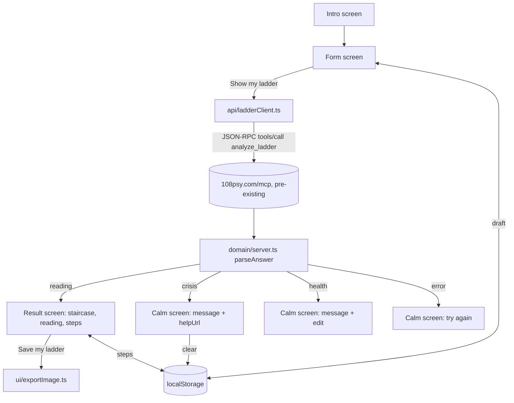

# Design Document

## Overview

Haunted Ladder is a static single-page app (Vite + TypeScript, plain DOM, inline SVG). It has four screens: intro, form, result (staircase + reading + steps) and calm (crisis, health or error). All logic that can be pure lives in `src/domain` and is covered by property-based tests with fast-check. The only network call goes to the pre-existing Ladder MCP server.

## Architecture



State is one plain object held in `main.ts`. Screens are rebuilt from state on every change; there is no framework.

## Components and Interfaces

### domain/ladder.ts

```ts
type LadderDraft = { goal: string; me: string; blocks: string[]; fears: string[] };
type FieldError = 'empty' | 'tooLong';
function validatePhrase(text: string): FieldError | null;      // trim, 1..300 chars
function validateDraft(d: LadderDraft): { ok: boolean; errors: Record<string, FieldError> };
function buildRequest(d: LadderDraft, id: number): JsonRpcRequest; // trims, drops empty fears, language 'en'
```

### domain/server.ts

```ts
type Step = { number: number; zone: 'current' | 'block' | 'goal' | 'fear'; zoneLabel: string; text: string };
type Reading = { kind: 'reading'; steps: Step[]; nearestBlock: string | null; fearsAboveGoal: number /* count of fears above the goal */;
  insights: string[]; questions: string[]; fullDiagnostic: { text: string; url: string };
  author: string; disclaimer: string };
type Crisis = { kind: 'crisis'; message: string; helpUrl: string };
type Health = { kind: 'health'; message: string };
type Failure = { kind: 'error'; reason: 'network' | 'rpc' | 'shape' | 'timeout' };
type Answer = Reading | Crisis | Health | Failure;
function parseAnswer(raw: unknown): Answer;            // never throws
function rewriteUtm(url: string): string;              // chatgpt_plugin -> haunted_ladder
```

`parseAnswer` reads `result.structuredContent`, falls back to `JSON.parse(result.content[0].text)`, and returns `{kind:'error', reason:'shape'}` for anything that does not match.

### domain/ghosts.ts

```ts
type Ghost = { fear: string; step: string };
function ghostsFromReading(r: Reading): Ghost[];       // one ghost per fear step, server order
function isFaded(g: Ghost): boolean;                   // step.trim().length > 0
function allFaded(gs: Ghost[]): boolean;               // true for an empty list
```

### domain/storage.ts

```ts
type Saved = { draft: LadderDraft; steps: Record<string, string> };
function save(s: Saved, store: Storage): void;
function load(store: Storage): Saved | null;           // null on missing or broken JSON
function clear(store: Storage): void;
```

Key: `haunted-ladder:v1`.

### api/ladderClient.ts

`analyze(draft, fetchImpl = fetch, timeoutMs = 20000): Promise<Answer>` posts the request with `Content-Type: application/json` and `Accept: application/json, text/event-stream`, aborts on timeout and passes the body to `parseAnswer`.

### ui modules

- `form.ts`: one question per screen, live validation, add/remove rows up to 5.
- `staircase.ts`: builds the SVG from `Reading` and `Ghost[]`. Steps go from bottom left to top right. Ghost opacity is 1 or 0.15.
- `reading.ts`: insights, questions, step inputs, disclaimer, diagnostic link, save button.
- `calm.ts`: crisis, health and error screens. It adds class `calm` to `<body>`, which hides every spooky layer.
- `exportImage.ts`: serializes the SVG, draws it on a canvas at 2x and downloads `haunted-ladder.png`.
- `heart.ts`: inline SVG x-ray heart drawn behind the staircase. It reads the beat rate from `domain/pulse.ts` and sets the CSS variable `--beat` (seconds per beat) on the heart element. CSS does the beat with a scale and glow keyframe.
- `fog.ts`: two layers of blurred SVG shapes that drift while waiting; `lift()` fades them out and adds a `lit` class to each step with a growing delay, bottom up.
- `intro.ts`: builds the intro screen: a full-width inline SVG night scene (moon with a radial-gradient halo, 12 to 20 stars at fixed positions, a ladder silhouette fading into a fog band, one small ghost behind a rail), the title with class `flicker`, and two buttons, "Start" and "See a sample ladder" (a link to `?demo=1`). Motion is CSS only and lives under `@media (prefers-reduced-motion: no-preference)`.
- `dawn.ts`: `isDawn(ghosts)` is true when there is at least one ghost and every ghost has a non-empty step. `setDawn(scene, on)` toggles class `dawn` on the result stage; CSS moves the sky gradient, stars, moon, sun and fog with transitions (4 s in, 2 s out, none under reduced motion). The dawn line text comes from the dictionary.
- `motes.ts`: `dissolve(svg, ghostIndex, target)` adds 8 to 14 SVG circles at the ghost, animates them up toward the moon or sun with the Web Animations API, and removes them on finish. Does nothing under reduced motion. `nightSound.chime()` plays the soft chime only while the sound is on.
- `i18n.ts` with `locales/en.ts`, `locales/ru.ts`, `locales/kk.ts`: `t(key)`, `getLang()`, `setLang(lang)`; the language is saved in `localStorage` and sets `<html lang>`. The Russian and Kazakh question texts are copied from the Ladder server's `get_ladder_questions`.
- `nightSound.ts`: Web Audio only, no files. Wind is filtered brown noise with a slow gain wobble. The heartbeat is two short low sine thumps ("lub-dub") scheduled on the audio clock at the current beat rate. `start()` needs a user gesture; `stop()` ramps gain to 0 in 2 seconds; `kill()` stops at once (used by the calm screens).

#### Side staircase layout (Requirement 17)

The look follows `Ladder.tsx` on 108psy.com: plate i (0 = the "I" step) sits at `x = pad + i * w`, `y = top + (N - 1 - i) * row`, so the staircase rises to the right, with the floor line under plate 0.

- One geometry for every width: `vw = clamp(containerWidth, 300, 680)` (0 or missing means 680), 1 SVG unit = 1 CSS px, `data-layout="narrow"` below 640 and `"wide"` otherwise.
- `pad = 12`, `row = 60`, `top = 64` (room for the banister and the moon), floor 28 below the last row.
- Stair area: `stairW = min(round(vw * 0.42), vw - 2 * pad - 14 - 160)` so cards always keep at least 160 px; plate width `w = clamp(floor(stairW / N), 10, 56)`; plate height `row - 8` with `rx = 5`. A 2 px darker copy under each plate stands in for a shadow (no SVG filter, so the saved picture matches).
- Number: centered, bold, 13 px when `w >= 24`, 11 px when `w >= 16`, and left out on thinner plates (the plate's `<title>` and `aria-label` still carry the number and words). Badges ("me", "goal") are small pills (class `badge`, 11 px bold text, solid fill with AA contrast) at the start of the first line of their note card, so they never collide with the banister or the next plate.
- Banister: one post per plate (2 px wide, 22 px tall from the plate's top left corner) and a rail through the post tops.
- Notes column: `noteX = pad + N * w + 14`, card width `vw - pad - noteX`, card height 54 centered on the plate row, `rx = 8`, solid `NIGHT_2` fill, 13 px text, up to 3 wrapped lines with `wrapText` and `charWidth(13)`. Fear cards keep 34 px on the left for the ghost (body drawn at scale 0.5 in an inner group, so `.ghost-body` keeps a plain `translate(x y)` for `motes.ts`).
- Leader line: from `(plate right, plate middle)` to `(noteX, plate middle)`, 1 px `MIST`, with a 2.5 px dot at the plate end; dashed for the goal.
- Colors: "I" plate `MOON` with `NIGHT` number; obstacle `NIGHT_2` with `MIST` outline and a 3-thread cobweb in the top left corner; nearest obstacle outline `PUMPKIN` 2.5 px; goal plate `PUMPKIN` with `NIGHT` number and the `.goal-light` lantern (a small circle with a crisp ring) above it; fear plate dashed `MIST` outline with no fill until its ghost fades, then class `lit` with `MOON` outline and `NIGHT_2` fill.
- Faded ghost: the `.ghost-float` group gets opacity 0.15, the check mark shows, the label turns `MIST` and keeps AA contrast on `NIGHT_2`.
- Moon in the empty top left corner above the low plates.

`heart.ts` (Requirement 17.6) becomes a pulse panel: a flex row above the staircase with a 56 px crisp heart (path with a linear gradient from `#E23B4E` to `PUMPKIN`, a 1.5 px `MOON` outline, one small highlight, no filter and no blur), a pulse line (an SVG polyline with a flat line and one beat spike, moved with a CSS animation whose length is `var(--beat)`), and the beat rate text from `t('heartRate')`, always visible. The panel is in normal flow before the staircase, not absolutely placed over it.

### domain/pulse.ts

```ts
function beatsPerMinute(unfaded: number): number;   // min(60 + 12 * max(unfaded, 0), 120)
function secondsPerBeat(bpm: number): number;       // 60 / bpm
```

### domain/settings.ts

```ts
type Settings = { sound: boolean };
function saveSettings(s: Settings, store: Storage): void;   // key haunted-ladder:settings
function loadSettings(store: Storage): Settings;            // { sound: false } on missing or broken JSON
```

### domain/demo.ts

```ts
function isDemo(search: string): boolean;   // true exactly when the query has demo=1
function demoDraft(): LadderDraft;          // sample ladder from tech.md with 3 fears; passes validateDraft
```

`main.ts` loads the demo into memory only. It never calls `save` while the demo draft is unchanged.

## Data Models

See the types above. The draft and steps are the only persisted data. Nothing from the server is persisted.

## Error Handling

- Network error, timeout, JSON-RPC `error`, or a body that fails `parseAnswer`: calm error screen with "Try again" (re-sends the same draft) and "Edit answers".
- `localStorage` throws (private mode, quota): the app keeps working in memory and does not show an error.
- `canvas.toBlob` fails: show "Could not save the picture" and keep the screen.

## Correctness Properties

Property 1: Phrase validation
For any string s, `validatePhrase(s)` returns null exactly when `1 <= s.trim().length <= 300`.
Validates: Requirements 1.3

Property 2: Request respects the server limits
For any draft that passes `validateDraft`, `buildRequest` produces `blocks` with 3 to 5 items, `fears` with 0 to 5 items, every phrase trimmed and 1 to 300 characters, and `language` equal to `"en"`.
Validates: Requirements 1.2, 1.4, 2.1

Property 3: Words are kept exactly
For any valid draft, the trimmed phrases in the request are equal to the trimmed phrases typed, in the same order.
Validates: Requirements 2.1, 3.2

Property 4: Parsing never throws and never invents a reading
For any JSON value v, `parseAnswer(v)` returns without throwing, and returns `kind: 'reading'` only when v contains a structurally valid reading.
Validates: Requirements 2.6

Property 5: Crisis wins
For any answer with `kind: 'crisis'`, the rendered page contains no element with the classes `stair`, `ghost`, `cobweb`, `moon`, `fog` or `heart`, `nightSound.kill()` has been called, and the saved draft is removed.
Validates: Requirements 6.1, 6.3, 6.4, 9.8

Property 6: Ghost fading
For any ghost g, `isFaded(g)` is true exactly when `g.step.trim()` is not empty; `allFaded` is true exactly when every ghost is faded.
Validates: Requirements 5.2, 5.3, 5.4

Property 7: One ghost per fear
For any reading r, `ghostsFromReading(r).length` equals the number of steps in r with `zone: 'fear'`, in the same order.
Validates: Requirements 3.3, 3.4

Property 8: UTM rewrite
For any URL u with `utm_source=chatgpt_plugin`, `rewriteUtm(u)` has `utm_source=haunted_ladder` and every other query parameter, the path and the host unchanged.
Validates: Requirements 4.3

Property 9: Storage round trip
For any saved state s, `load(save(s))` deep-equals s; `load` returns null for any broken JSON instead of throwing.
Validates: Requirements 1.6, 5.5

Property 10: Text is never HTML
For any phrase containing `<`, `>` or `&`, the rendered staircase contains the literal characters as text and no new elements.
Validates: Requirements 3.5

Property 11: Calmer with every step
For any counts a < b, `beatsPerMinute(a) <= beatsPerMinute(b)`; for any count, the result is between 60 and 120; `beatsPerMinute(0)` is 60.
Validates: Requirements 9.2, 9.3

Property 12: Silence by default
For any stored settings, including broken JSON, the app creates no `AudioContext` until a click on the "Night sound" button, and `loadSettings` never throws.
Validates: Requirements 9.6, 9.7

Property 13: The demo is honest
For any query string q, `isDemo(q)` is true exactly when q has the parameter `demo` equal to `1`; `demoDraft()` passes `validateDraft`; loading the demo leaves any saved draft in storage unchanged.
Validates: Requirements 10.1, 10.3

Property 14: Labels stay readable
For any reading with 1 to 5 obstacles and 1 to 5 fears and any phrases, every step label in the staircase SVG is drawn after (above) the heart and on a filled step rectangle whose color with the label color has contrast of at least 4.5:1, and the bounding boxes of ghost labels computed from their x, y and wrapped line count do not overlap each other.
Validates: Requirements 11.3

Property 15: Readable on a phone
For any reading with 1 to 5 obstacles and 1 to 5 fears and any phrases, the staircase built for a 375 px wide container has every step label and ghost label font size times (rendered width / viewBox width) of at least 13, every wrapped line fits its slot width, and Property 14 still holds.
Validates: Requirements 12.3

Property 16: Dawn comes only with every step
For any list of 0 to 5 ghosts with any steps, `isDawn` is true exactly when the list is not empty and every step is non-empty after trimming; setting and clearing steps in any order leaves the stage class `dawn` equal to `isDawn`.
Validates: Requirements 13.1, 13.2, 13.3

Property 17: Motes leave no trace
For any sequence of 1 to 20 step adds and clears, after all mote animations finish the SVG contains no mote elements, and under reduced motion no mote is ever created.
Validates: Requirements 14.2, 14.4

Property 19: A night staircase that reads
For any reading with 1 to 5 obstacles and 0 to 5 fears, any phrases, and any container width from 300 to 680 px: there is exactly one `.stair` with `data-zone` per step in reading order with the full words in its `<title>`, carpet step i+1 is to the right of and exactly one rise above step i, every carpet step lies inside the night scene, every card lies under the scene and inside the viewBox, no two cards overlap, card text is 13 px or larger and every wrapped line fits its card after the number and emblem, every number, badge and card text has contrast 4.5:1 or more against its own fill, there is one goal light and one cobweb per obstacle.
Validates: Requirements 17.4, 17.7, 19.1 to 19.4

Property 20: A clear heart apart from the text
For any list of 0 to 5 ghosts with any steps, the heart panel comes before the staircase in the stage and is not laid over it, has no blur filter and no body fill opacity below 1, always shows the beat rate as text equal to `beatsPerMinute` of the unfaded ghosts (after the ease), and holds one pulse line whose animation length follows `--beat`.
Validates: Requirements 17.6, 9.2

Property 18: Same words in every language
The `en`, `ru` and `kk` dictionaries have the same key set, no value is empty, and no value in any language contains "psycholog", "therapist", "психолог" or "психотерапевт" (case-insensitive).
Validates: Requirements 15.2, 15.5

Property 21: The Zheztyrnaq turns into a Peri
For any reading and any steps on the fears, every ghost holds exactly one Zheztyrnaq image and one Peri image; the Zheztyrnaq has opacity 1 and the Peri 0 exactly when the ghost has no step, and the other way round when it has one, with the check shown only then; every non-fear card holds exactly one emblem that matches its zone (I: shanyraq, nearest obstacle: asyq, other obstacles: tumar, goal: burkit) and its text starts to the right of the emblem; every `<image>` in the staircase, the ghost heading and the legend points to `BASE_URL + "art/"`, is hidden from screen readers, and the backdrop comes right after the night sky fill; and in the saved SVG every `<image>` href starts with `data:`.
Validates: Requirements 18.1 to 18.9

## Testing Strategy

- Vitest + jsdom for unit and DOM tests, fast-check for Properties 1 to 13 (at least 100 runs each). `AudioContext` is replaced by a fake in tests.
- `ladderClient` is tested with a fake `fetch`: reading, crisis, health, rpc error, broken JSON, timeout.
- One manual check before the demo video: a real call to the server with the sample ladder from `tech.md`, keyboard-only pass, reduced-motion pass, crisis wording pass (the server decides crisis; we only check that our screen follows Requirement 6).
