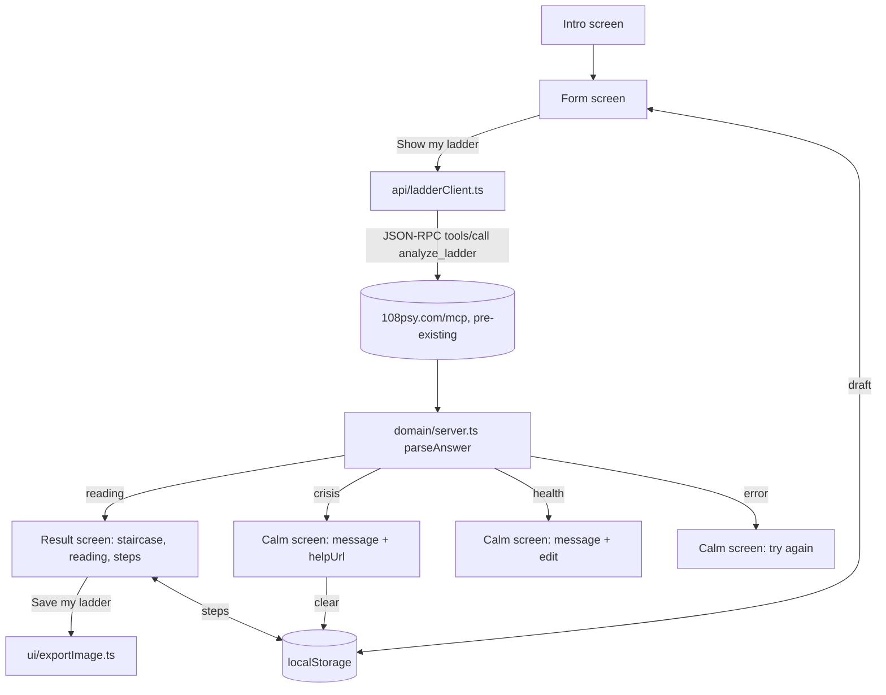

# Design Document

## Overview

Haunted Ladder is a static single-page app (Vite + TypeScript, plain DOM, inline SVG). It has four screens: intro, form, result (staircase + reading + steps) and calm (crisis, health or error). All logic that can be pure lives in `src/domain` and is covered by property-based tests with fast-check. The only network call goes to the pre-existing Ladder MCP server.

## Architecture



State is one plain object held in `main.ts`. Screens are rebuilt from state on every change; there is no framework.

## Components and Interfaces

### domain/ladder.ts

```ts
type LadderDraft = { goal: string; me: string; blocks: string[]; fears: string[] };
type FieldError = 'empty' | 'tooLong';
function validatePhrase(text: string): FieldError | null;      // trim, 1..300 chars
function validateDraft(d: LadderDraft): { ok: boolean; errors: Record<string, FieldError> };
function buildRequest(d: LadderDraft, id: number): JsonRpcRequest; // trims, drops empty fears, language 'en'
```

### domain/server.ts

```ts
type Step = { number: number; zone: 'current' | 'block' | 'goal' | 'fear'; zoneLabel: string; text: string };
type Reading = { kind: 'reading'; steps: Step[]; nearestBlock: string | null; fearsAboveGoal: string[];
  insights: string[]; questions: string[]; fullDiagnostic: { text: string; url: string };
  author: string; disclaimer: string };
type Crisis = { kind: 'crisis'; message: string; helpUrl: string };
type Health = { kind: 'health'; message: string };
type Failure = { kind: 'error'; reason: 'network' | 'rpc' | 'shape' | 'timeout' };
type Answer = Reading | Crisis | Health | Failure;
function parseAnswer(raw: unknown): Answer;            // never throws
function rewriteUtm(url: string): string;              // chatgpt_plugin -> haunted_ladder
```

`parseAnswer` reads `result.structuredContent`, falls back to `JSON.parse(result.content[0].text)`, and returns `{kind:'error', reason:'shape'}` for anything that does not match.

### domain/ghosts.ts

```ts
type Ghost = { fear: string; step: string };
function ghostsFromReading(r: Reading): Ghost[];       // one ghost per fear step, server order
function isFaded(g: Ghost): boolean;                   // step.trim().length > 0
function allFaded(gs: Ghost[]): boolean;               // true for an empty list
```

### domain/storage.ts

```ts
type Saved = { draft: LadderDraft; steps: Record<string, string> };
function save(s: Saved, store: Storage): void;
function load(store: Storage): Saved | null;           // null on missing or broken JSON
function clear(store: Storage): void;
```

Key: `haunted-ladder:v1`.

### api/ladderClient.ts

`analyze(draft, fetchImpl = fetch, timeoutMs = 20000): Promise<Answer>` posts the request with `Content-Type: application/json` and `Accept: application/json, text/event-stream`, aborts on timeout and passes the body to `parseAnswer`.

### ui modules

- `form.ts`: one question per screen, live validation, add/remove rows up to 5.
- `staircase.ts`: builds the SVG from `Reading` and `Ghost[]`. Steps go from bottom left to top right. Ghost opacity is 1 or 0.15.
- `reading.ts`: insights, questions, step inputs, disclaimer, diagnostic link, save button.
- `calm.ts`: crisis, health and error screens. It adds class `calm` to `<body>`, which hides every spooky layer.
- `exportImage.ts`: serializes the SVG, draws it on a canvas at 2x and downloads `haunted-ladder.png`.

## Data Models

See the types above. The draft and steps are the only persisted data. Nothing from the server is persisted.

## Error Handling

- Network error, timeout, JSON-RPC `error`, or a body that fails `parseAnswer`: calm error screen with "Try again" (re-sends the same draft) and "Edit answers".
- `localStorage` throws (private mode, quota): the app keeps working in memory and does not show an error.
- `canvas.toBlob` fails: show "Could not save the picture" and keep the screen.

## Correctness Properties

Property 1: Phrase validation
For any string s, `validatePhrase(s)` returns null exactly when `1 <= s.trim().length <= 300`.
Validates: Requirements 1.3

Property 2: Request respects the server limits
For any draft that passes `validateDraft`, `buildRequest` produces `blocks` with 3 to 5 items, `fears` with 0 to 5 items, every phrase trimmed and 1 to 300 characters, and `language` equal to `"en"`.
Validates: Requirements 1.2, 1.4, 2.1

Property 3: Words are kept exactly
For any valid draft, the trimmed phrases in the request are equal to the trimmed phrases typed, in the same order.
Validates: Requirements 2.1, 3.2

Property 4: Parsing never throws and never invents a reading
For any JSON value v, `parseAnswer(v)` returns without throwing, and returns `kind: 'reading'` only when v contains a structurally valid reading.
Validates: Requirements 2.6

Property 5: Crisis wins
For any answer with `kind: 'crisis'`, the rendered page contains no element with the classes `stair`, `ghost`, `cobweb` or `moon`, and the saved draft is removed.
Validates: Requirements 6.1, 6.3, 6.4

Property 6: Ghost fading
For any ghost g, `isFaded(g)` is true exactly when `g.step.trim()` is not empty; `allFaded` is true exactly when every ghost is faded.
Validates: Requirements 5.2, 5.3, 5.4

Property 7: One ghost per fear
For any reading r, `ghostsFromReading(r).length` equals the number of steps in r with `zone: 'fear'`, in the same order.
Validates: Requirements 3.3, 3.4

Property 8: UTM rewrite
For any URL u with `utm_source=chatgpt_plugin`, `rewriteUtm(u)` has `utm_source=haunted_ladder` and every other query parameter, the path and the host unchanged.
Validates: Requirements 4.3

Property 9: Storage round trip
For any saved state s, `load(save(s))` deep-equals s; `load` returns null for any broken JSON instead of throwing.
Validates: Requirements 1.6, 5.5

Property 10: Text is never HTML
For any phrase containing `<`, `>` or `&`, the rendered staircase contains the literal characters as text and no new elements.
Validates: Requirements 3.5

## Testing Strategy

- Vitest + jsdom for unit and DOM tests, fast-check for Properties 1 to 10 (at least 100 runs each).
- `ladderClient` is tested with a fake `fetch`: reading, crisis, health, rpc error, broken JSON, timeout.
- One manual check before the demo video: a real call to the server with the sample ladder from `tech.md`, keyboard-only pass, reduced-motion pass, crisis wording pass (the server decides crisis; we only check that our screen follows Requirement 6).
