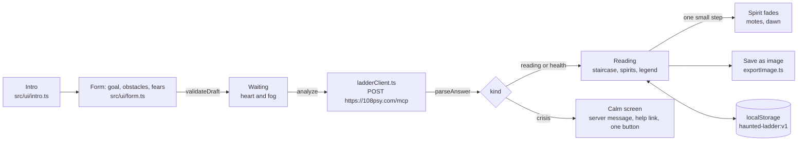
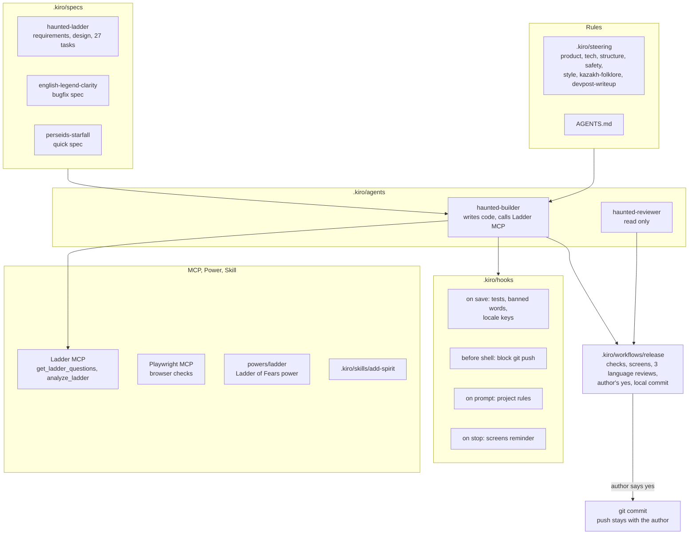

# Architecture

Haunted Ladder is a static one-page app (Vite, TypeScript, no framework). The only network call is `analyze_ladder` on the Ladder MCP server. Everything else runs in the browser.

## The app

- `src/domain`: pure logic with property tests in `tests/domain` (draft rules, server answer parsing, spirits from fears, saved steps).
- `src/ui`: screens and SVG pictures. User text goes only through `textContent` or SVG text nodes.
- `src/locales`: every string in English, Russian and Kazakh with the same keys.
- Crisis answers skip the staircase, spirits, sound and decoration on purpose.

## How Kiro builds it

- Every Kiro chat that built the app is exported to `kiro-sessions/` by `npm run export:sessions`.
- Hook runs are logged locally to `.kiro/hook-runs.log`.
