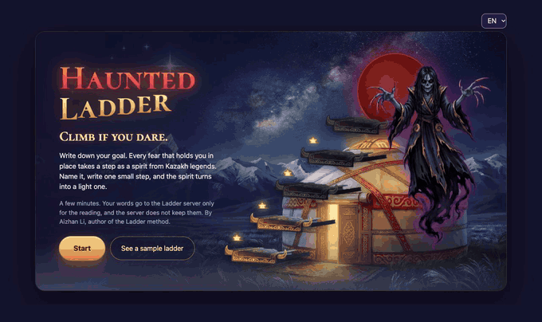

# Haunted Ladder

Your fears are ghosts on the stairs to your goal.



Haunted Ladder is a spooky but gentle self-check built on the Ladder method by Aizhan Li, author of the Ladder method. You write a goal, where you are now, 3 to 5 obstacles and up to 5 fears. The app draws a night staircase under a Kazakh steppe sky: obstacles hang on the stairs as cobwebs, fears float above the goal as spirits. For each fear you write one small step for this week. The copper-clawed witch (Zheztyrnaq) turns into a bright golden spirit (Peri), a glowing heart slows down, and dawn comes when every fear has a step. You can save the finished ladder as a picture. The app works in English, Russian and Kazakh.

Fears feel bigger when they are vague. Here a fear gets a name, a face and a next step.

## Links

- Live app: https://liaizhan.github.io/haunted-ladder/
- Demo link, one click to a sample ladder: https://liaizhan.github.io/haunted-ladder/?demo=1
- Repo: https://github.com/liaizhan/haunted-ladder
- Demo video (2:15): https://youtu.be/eXYeqlLO1nw

Free to test, no login, no payment, available at least until 29 January 2027.

## Summary for judges

- **Category:** Costume Contest. **Bonus:** Best Startup Project. Aizhan Li is the founder of the startup behind the Ladder method, https://108psy.com.
- **What:** a Halloween costume for a real self-check. A glowing heart beats faster for every fear without a step and calms down as each one gets a step.
- **Who it is for:** people who feel stuck between where they are and a goal. The same Ladder method already runs on [108psy.com](https://108psy.com) and in the Ladder plugin in ChatGPT.
- **Try it fast:** open the demo link. It sends a sample ladder to the real Ladder server and shows the result. Nothing is invented on the client.
- **Safety is the spine:** a crisis answer from the server removes the whole costume.

## Safety

The costume never comes before the person. If the Ladder server detects a crisis in the words, the app removes every Halloween element, stops all sound at once and shows only a calm message, a link to help and one button back. No jump scares. Sound is off on every page load and starts only after a press on "Night sound", with a slow fade. The app does not diagnose and does not promise any health or life result. It is a tool for self-reflection, not therapy.

## Privacy

No backend, no accounts, no analytics, no cookies. Fonts and pictures are served with the app itself. The only request to another server is the reading from the Ladder server. It receives the goal, the current state, the obstacles and the fears. It never receives the small steps you write for the ghosts, and the server does not keep the text.

Your draft stays in your browser's `localStorage` under three keys: `haunted-ladder:v1` (draft and steps), `haunted-ladder:settings` (sound choice) and `haunted-ladder:lang` (language). "Clear my answers" removes the draft, and so does a crisis answer.

## How it was built with Kiro

### Specs

- `.kiro/specs/haunted-ladder/`: 19 requirements in EARS form, a design with 21 correctness properties tested with fast-check, and 27 top-level tasks. `requirements-analysis.md` there is a review of the requirements against the code.
- `.kiro/specs/english-legend-clarity/`: a bugfix spec for the English legend wording.
- `.kiro/specs/perseids-starfall/`: a quick spec for the waiting-screen starfall.

Honest note: the core (draft rules, parsing of the server answer, crisis handling, storage) went through the full spec with property tests. Small visual tweaks went through the quick spec, and the legend wording through the bugfix spec.

### Steering

`.kiro/steering/` has 7 files: `product`, `tech`, `structure`, `safety`, `style`, `kazakh-folklore` and `devpost-writeup`. `tech.md` pulls in live code files, so the server contract in the rules cannot drift from the code.

### Hooks

`.kiro/hooks/` has 9 files with 10 hooks:

- On file save: `run-tests-on-save`, `words-check-on-save` (forbidden wording, `innerHTML`, autoplay), `locales-keys-check`.
- After each spec task: `safety-and-style-check`.
- On prompt submit: `prompt-guard`.
- Before a shell command: `block-git-push`.
- On agent stop: `screens-reminder`.
- Manual: `take-screens`.
- Before and after context compaction: `compact-log`.

Hook runs are logged locally to `.kiro/hook-runs.log`, which is git-ignored.

### Custom agents

- `.kiro/agents/haunted-builder.json`: writes code, has the Ladder MCP and a tool allowlist.
- `.kiro/agents/haunted-reviewer.json`: read only.

Permissions are real, not trust: the reviewer cannot write, the builder has an allowlist, a hook blocks `git push`, and the release workflow waits for the author's yes.

### MCP

`.kiro/settings/mcp.json` connects two servers: the Ladder MCP (`get_ladder_questions`, `analyze_ladder` at `https://108psy.com/mcp`) and Playwright MCP for browser checks.

### Power and skill

- Power: `powers/ladder` (`POWER.md`, `mcp.json`, `steering/reading-guide.md`).
- Skill: `.kiro/skills/add-spirit/SKILL.md`, how to add a spirit with its picture, its legend line in three languages and its tests.

### Release workflow

`.kiro/workflows/release.workflow.json`: checks, screenshots, three language reviews, then a wait for the author's yes and a local commit. Push stays with the author.

### Kiro IDE and CLI

The app was built in the Kiro IDE (33 chats) and with the Kiro CLI, `kiro-cli` (5 chats, for example the read-only reviewer checking an earlier version of this README against the rules, and the builder agent rewriting it).

### Exported sessions

All 38 chats are exported to `kiro-sessions/` by `npm run export:sessions`. See `kiro-sessions/README.md`.

## Architecture

- [ARCHITECTURE.md](ARCHITECTURE.md): diagrams of the app and of the Kiro setup.
- [AGENTS.md](AGENTS.md): commands, hard rules and where things are, for any coding agent.

## Run locally

Needs Node 20 (the CI uses 20).

```bash
npm install
npm run dev
```

Then open http://localhost:5173/haunted-ladder/

```bash
npm test                 # Vitest, jsdom and fast-check
npm run build            # type check and production build
npm run screens          # screenshots of the main screens into screens/ (needs Google Chrome)
npm run check:locales    # same keys in en, ru and kk
```

## Third-party material and pre-existing work

- **Font:** Cormorant SC (bold; latin, cyrillic and cyrillic-ext woff2 in `public/fonts`) by Christian Thalmann, under the SIL Open Font License 1.1 (full text in `public/fonts/OFL.txt`).
- **Art:** the pictures in `public/art` were generated with AI image tools for this project, then chosen and approved by the author.
- **Playwright MCP:** a third-party dev tool used for browser checks.
- **Libraries:** Vite, TypeScript, Vitest, fast-check and jsdom, used for development and build.
- **The Ladder method and the Ladder MCP server:** the method and the server at `https://108psy.com/mcp` (tools `analyze_ladder` and `get_ladder_questions`) existed before the hackathon. They power 108psy.com and the Ladder plugin in ChatGPT. Haunted Ladder only calls this public server.
- **Everything else in this repository** (specs, steering, hooks, agents, app code, tests, graphics) was made during the submission period, from 30 October 2026.

## License

MIT, see [LICENSE](LICENSE).
